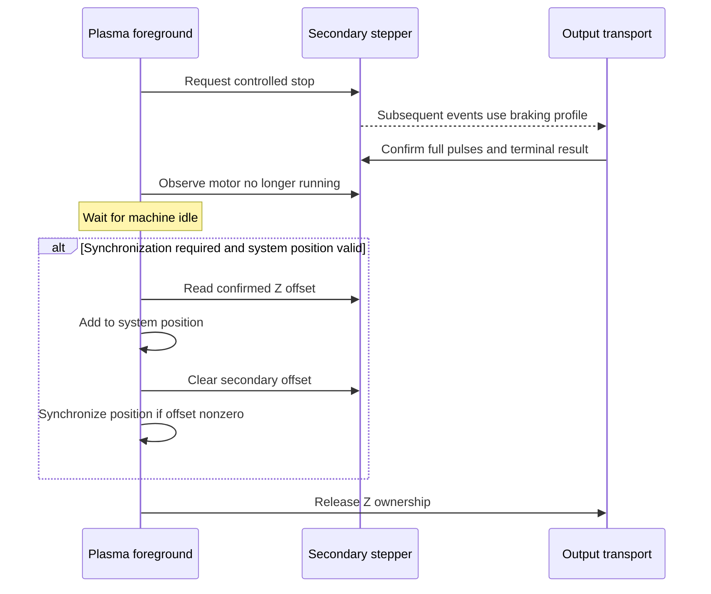

# Plasma integration with confirmed stream motion

Buffered secondary-stepper output introduces a delay between generating a Z
correction and confirming its complete output pulses. Plasma must retain Z
ownership until the secondary motor is no longer active, and must incorporate
the confirmed offset before handing the axis back to normal motion.

This change connects the core completion contract to Plasma position accounting
and axis handover. The [series overview](https://github.com/grblHAL/ESP32/issues/220)
places it alongside the [core stream support](https://github.com/grblHAL/core/pull/1025)
and the ESP32 I2S transport.

## Position handover in thc.c

`state_await_idle` requests `st2_motor_stop` while the secondary motor is running.
In stream mode, running includes queued output still draining. Once the motor is
inactive and the machine is idle, the code checks whether synchronization is
required and whether `sys.position_lost` is clear.

Synchronization is enabled by the existing `plasma.option.sync_pos` option or,
when compiled with `STEP_INJECT_STREAM`, by a non-NULL `hal.stepper.injection`.
For a nonzero confirmed secondary position the handover then performs:

1. Read the offset with `st2_get_position(z_motor)`.
2. Add it to `sys.position[Z_AXIS]`.
3. Clear the secondary offset with `st2_set_position(z_motor, 0LL)`.
4. Call `sync_position()`.
5. Release Z through `hal.stepper.claim_motor(Z_AXIS, false)`.

The release follows the synchronization block. If system position is marked
lost, the offset is not synchronized; release is still reached when the idle
conditions hold. The condition checks `sys.position_lost`, the system-level
position-validity flag. The secondary motor separately tracks its own private
position-validity state.

`state_await_puddle_clear` also accounts for the confirmed offset after the motor
stops when synchronization is required. It adds the offset and clears the
secondary count; unlike the final idle handover, that block does not call
`sync_position()` or release the axis.

## Dependencies and verification boundary

The integration code revision is `6c90199`, paired with core `f628524` and ESP32
`739b0e9` in the integration series. Core supplies confirmed position and terminal
activity semantics; ESP32 supplies the stream transport and axis ownership.
The companion core document is `doc/stream-injection.md`; the ESP32 overview is
`doc/i2s-injection.md`.

### Verification

Source review of `6c90199` covers both modified state handlers:

| Condition | Behavior in the code |
|---|---|
| Secondary motor active | Final handover requests controlled stop and retains the axis |
| Motor inactive, machine not idle | Final handover waits |
| Stream transport present, system position valid | Offset accounting is enabled independently of the optional direct-mode sync setting |
| System position marked lost | Offset accounting is skipped; final idle handover still releases the axis |
| Nonzero offset at final handover | Add offset, clear secondary count, synchronize, then release Z |
| Zero offset at final handover | Release Z without an additional position update |
| Puddle-clear completion | Schedule THC start; account for and clear a valid offset while retaining the axis |
| Stream configuration disabled | Synchronization selection uses the existing `sync_pos` option, with the position-validity check |

A complete `dlc32-stream` firmware build with Plasma and stream injection enabled
passed compilation and linking using ESP32 `739b0e9`, core `d6a4f22` and Plasma
`6c90199`. The build used PlatformIO Espressif 32 `5.3.0` and framework package
`framework-espidf@3.40403.0`. Core `d6a4f22` adds documentation to the stream
implementation at `f628524`.

The table records source-review findings; the firmware build establishes
integration at compilation and linking. Runtime state transitions, physical
motion and the subsequent planner move on Z require their own test evidence.

Machine settings remain described in the [Plasma README](../README.md).
There are no universal PID, voltage, travel or feed settings for this feature.
